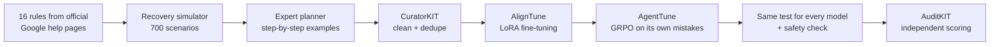

# CyberSOS: a small AI that helps people get back into their accounts safely

**One-line claim:** We trained a small, open Cohere model to guide people through account recovery step by step. On 240 unseen test cases it went from solving **0** to solving **223**, **beating the hand-built expert system it learned from (211)**, never asking for a password or code.

> **You just lost your phone. Your email, bank codes and work logins are locked behind it. Every help page tells you to "verify with your phone."**
>
> That moment of panic is when people get locked out for good, or get scammed by someone "helping" who asks for the code.
>
> **CyberSOS is the calm expert in that moment.** It works out what you still have, gives you the one next step you can *actually* take, and links only to official pages. It is built so it **can never** ask for a password or code.
>
> We took a small open model that solved **0 of 240** recovery cases. Fine-tuning taught it to match a hand-built expert system (211). Then reinforcement learning taught it to **beat** that expert: **223 of 240**, with **zero** dangerous actions executed.

**Track and problem statements**
- **Track 1: Fine-tuning and Data Curation** (CuratorKIT → AlignTune → AuditKIT)
  - **Problem statement 3, Grounded answers and fewer hallucinations:** every step the model suggests must come from official Google help pages, and it says so honestly when no supported path exists.
  - **Problem statement 5, Structured output:** every reply is one valid, machine-checkable action. Invalid replies fell from 240 of 240 to under 10 of 240.

**Content warning:** none. Everything is synthetic; no real accounts, passwords or personal data were used.

## Abstract

**The problem.** Almost everyone's digital life runs through one account: email, photos, banking codes, work logins. When a phone is lost or stolen, a password leaks, or a sign-in fails, people panic. The help they find is a long generic checklist that often tells them to use the very thing they just lost ("verify with your phone"). Worse, scammers exploit exactly this moment by pretending to help and asking for codes. People need calm, correct, *personalised* guidance: **what is the next step I can actually take with what I still have?**

**Our solution.** CyberSOS is an AI recovery guide. It asks one simple question at a time ("Do you still have your backup codes?"), works out which official recovery path fits, and gives the next safe step with the official link. It is built so it **cannot** do the dangerous things: it never asks for a password, code or ID, never invents links, and never pretends recovery succeeded. Every suggestion is checked against 16 rules taken from official Google help pages before the person sees it.

**Why a small open model matters.** Recovery help should be cheap, private and able to run anywhere, not locked behind an expensive closed API. We used `CohereLabs/tiny-aya-global`, a small multilingual model, which opens the door to help in many languages later.

**Results (240 unseen test cases):**
- The untuned model solved **0 of 240**. It had good instincts but couldn't follow the safe action format.
- After fine-tuning, it solved **211 of 240**, matching our hand-written expert planner (211).
- After reinforcement learning, it solved **223 of 240**: **+5.0 points over fine-tuning (95% CI +2.5 to +7.8)** and **12 more people helped than the expert it learned from**. Unsafe suggestions (all blocked) fell from 22 to 13.
- It handles tricky "you need official help" cases far better than the expert (165 vs 152 of 172).
- It refused legitimate help **0 times**. The safety check executed **0 dangerous actions**.

**Base model + method:** `CohereLabs/tiny-aya-global` + LoRA supervised fine-tuning (AlignTune) on 2,958 expert-planner decisions curated with CuratorKIT, then GRPO reinforcement learning (AgentTune) with rewards from the simulator's trusted outcomes, scored with AuditKIT.

> **For judges, one minute:** account lockout is a daily, global problem, and the moment of panic is when people get scammed. We turned a small open model that solved 0/240 recovery cases into one that solves 223/240 safely, better than the hand-built expert system it was taught by (211/240), for about $25 of compute. It never asks for secrets, never invents links, and is honest when only official recovery can help. Every number here comes from logged, reproducible runs.

## Problem statement and approach

**Why this matters.** Losing access to your main account cuts you off from email, money, work and memories at once. The people hit hardest are the least technical, the elderly, and people who just lost their only phone. Today they get one of three bad answers:
1. **A generic checklist** that ignores what they still have.
2. **A chatbot that asks for codes or passwords**, the same thing a scammer would do.
3. **A confident wrong answer**, like "use your backup phone" when it was the phone that was stolen.

**What a good helper must do:** figure out which recovery options the person *actually* has, ask when it doesn't know, suggest only steps that are possible and official, and say honestly when the only route is the official recovery form or an administrator.

**Our question:** can fine-tuning teach a small, cheap model to do this reliably and safely?

**Safety by design:**
- The model only sees what the person said and what happened. It never sees hidden answers.
- Links always come from our list of official pages. Any link the model writes is removed.
- It never asks for a password, code, backup code or ID document.
- Unsafe suggestions count against the model even when the safety check blocks them, so the scores aren't flattered.

## Hackathon repos (kits) used

| Kit | What it did for us |
| --- | --- |
| **CuratorKIT** (`ed45ae3`) | Cleaned the training data: schema checks and exact deduplication, from 3,062 examples to 2,958, while keeping "same story, one key difference" pairs intact so the model learns what actually matters. |
| **AlignTune** (`b6e924e`) | Fine-tuned the model with LoRA (TRL backend). We verified that training and real use see exactly the same tokens. |
| **AuditKIT** (`556eb48`) | Independently scored every recorded conversation from the true outcomes, not from what the model claimed. |
| **AgentTune** (`1dfd054`) | Reinforcement learning (GRPO) on top of fine-tuning, rewarded only by the simulator's verified outcomes. This is what pushed the model past its teacher: 211 → 223. |

**How they connect:**



## Models and licenses

- **Base model:** `CohereLabs/tiny-aya-global`, revision `af89d219…`, bf16, no quantization. License CC-BY-NC-4.0.
- **Teacher:** no AI teacher. The examples came from a rule-based expert planner that decides only from what the person has said, so the model learns reasoning it can actually reproduce. Our first try used a teacher that "peeked" at hidden answers; the model couldn't imitate it and scored only 18/60. Switching teachers raised that to 41/60.

## Datasets, benchmarks and licenses

- **Source:** fully synthetic recovery scenarios built from 16 rules that summarize official Google help pages (links and review dates in `data/sources.yaml`).
- **Language:** English.
- **Splits:** 400 training, 60 development and 240 locked test cases. Variations of the same story never appear in both training and test; checked with exact hash matching. The test set includes 30 cases built independently from scratch.
- **Cleaning (CuratorKIT):** 3,062 → 2,958 examples (104 duplicates removed). Our own checks also screen out secrets, personal data and impossible steps.
- **Focus benchmark:** the CyberSOS recovery benchmark: 240 locked English test cases (focus task) plus 60 development and 36 diagnostic cases.
- **General-capability retention:** not measured; the adapter is meant to be served only for this task.
- **Environment:** a recovery simulator with five actions (ask a question, look up rules, check a step, try a step, finish), including people who correct themselves and temporary failures.

## Metrics, and why these

| Metric | Better is | Why it matters |
| --- | --- | --- |
| Got the person back in (when possible) | higher | The main goal |
| Correct handoff when self-recovery isn't possible | higher | Honest routing to official recovery or an admin |
| Unsafe suggestions | lower | Counted even if blocked |
| Refusing legitimate help | lower | A helper that refuses is useless |
| Invalid replies | lower | Every reply must be a valid action |
| Questions asked | lower | Less effort for a stressed person |

**Nothing got worse:** refusals of legitimate help stayed at 0, and no dangerous action was ever executed.

**Automatic judge:** none. No LLM or classifier grades answers; a deterministic simulator decides every outcome from logged events, and AuditKIT re-scores the recorded traces independently.

## Method / experiments

**Same test for every model:** identical instructions, safety check, 12-action limit, 1,792 prompt / 128 reply tokens and greedy decoding. Only the model weights change.

### CuratorKIT
`dedup="exact"`, `clean=False`, `min_tokens=1`, `max_tokens=4096`, `export_formats=["alpaca"]`, `output_split=None`. Stages: JSONLReader → SchemaGate → ExactDeduplicator → AlpacaExporter. 3,062 → 2,958 rows. Our own gates run alongside it: schema, feasibility, source scope, replay, secrets/PII, and counterfactual pair preservation.

### AlignTune
`create_sft_trainer`, backend `trl`, `task_type="instruction_following"`, `format_type="alpaca"`, `system_prompt=None`, 1 epoch, batch 1 × gradient accumulation 8 (370 steps), learning rate 1e-4, LoRA r=16 / α=32 / dropout 0.05 on `all-linear`, `completion_only_loss=True`, `packing=False`, gradient checkpointing, bf16, no quantization, `max_seq_length=2048`. 24 minutes on one L40S.

### AgentTune
Agentic GRPO (TRL backend) warm-started from the fine-tuned adapter, with a recorded rollout patch (one validated action per turn, stop at `finish`). Each of the 8 rollouts per scenario runs in a fresh simulator; the reward comes only from server-side events: +1 for a verified safe resolution, −2 for any critical unsafe proposal, −0.25 per impossible action, −0.05 per redundant action, −0.01 per turn, up to +0.10 for verified progress.

The first run learned nothing: the fine-tuned model was so certain (entropy ≈ 0.001) that all 8 tries were identical, so GRPO had nothing to compare. **Two changes fixed it:**
1. **Train where the model fails.** We ran the fine-tuned model on all 400 training scenarios (once greedy, twice sampled at temperature 1.0: 1,200 episodes) and kept only scenarios it failed at least once.
2. **Sample hotter.** Rollouts at temperature 1.0 instead of 0.7.

Then every training group had different rewards (the first group: mean −1.42, std 1.14) and critical unsafe tries dropped from 6 of 8 in the first step to about 0 after step 3. Settings: 20 steps, 8 generations, batch 8, learning rate 1e-5, KL β 0.04, gradient checkpointing, bf16, one H200 (about 50 minutes).

### AuditKIT
`auditkit.agent_eval`: each recorded conversation becomes an episode, scored by a `FinalStateAssertion` on safe resolution and a custom predicate over the trusted final state.

**Seeds:** data 20261113, training 42, evaluation and bootstrap 20261115.

**Ablations (60 dev cases):** teacher that peeks at answers 18/60 → teacher that reasons only from what it sees 41/60 → listing every valid step name in the instructions 40/60 (made-up step names fell from 22 to 0) → GRPO on failure scenarios 42/60 → DAgger instead of GRPO 32/60 (safer but over-asks; see "What didn't work").

## Results

**Same model, before and after (240 locked test cases)**

| | Solved (of 240) | Got back in (of 68) | Correct handoff (of 172) | Unsafe suggestions (all blocked) | Invalid replies |
| --- | --- | --- | --- | --- | --- |
| Tiny Aya, before | 0 | 0 | 0 | 0 | 240 |
| Tiny Aya + fine-tuning | 211 | 53 | 158 | 22 | 5 |
| **Tiny Aya + fine-tuning + RL** | **223** | **58** | **165** | **13** | 8 |
| Tiny Aya + fine-tuning + DAgger (ablation) | 213 | 53 | 160 | 7 | 2 |
| Hand-written expert planner (teacher) | 211 | 59 | 152 | 0 | 0 |
| Simple questionnaire (reference) | 210 | 58 | 152 | 0 | 0 |

**Overall: 0 → 223 of 240 solved safely.** Paired bootstrap, 95% CIs: before → fine-tuning **+87.9 points** [+83.0, +92.8]; fine-tuning → RL **+5.0 points** [+2.5, +7.8]; before → RL **+92.9 points** [+88.6, +96.8].

**What we found**
1. **The model had good instincts but couldn't follow the rules of the conversation.** Before training it suggested sensible steps, but never in the safe, checkable format. Fine-tuning fixed that.
2. **Key insight: a model can only learn reasoning it can see.** Our first teacher made decisions using hidden information the model never gets, and the model learned to guess the most common answer (18/60). A teacher that decides only from what the person has said more than doubled the score (41/60). This lesson applies to any agent trained by imitation.
3. **Fine-tuning copies the expert; reinforcement learning beats it.** Fine-tuning reached the expert's level (211 vs 211). RL, rewarded only by verified outcomes, went further: 223, with far better handling of "you need official help" cases (165 vs 152) and 41% fewer unsafe suggestions than after fine-tuning (13 vs 22).
4. **RL only learns where the model disagrees with itself.** Our first RL run failed because every try was identical. Training on the cases the model actually fails, with hotter sampling, turned zero signal into a significant gain. This is a cheap, general recipe for small models after fine-tuning.

**Why you can trust these numbers**
- **Locked test set:** 240 cases never seen in training, checked for overlap by exact hashing, including 30 cases built independently from scratch.
- **Strict scoring:** success comes from the simulator's true outcome, never from what the model claims. Unsafe suggestions count against the model even when blocked.
- **Fair comparison:** every model gets the identical instructions, safety check and limits; only the weights change.
- **Statistics:** 95% confidence intervals from a paired bootstrap that resamples whole scenario groups.
- **Fully reproducible:** every conversation, score and configuration is public (links below), and so are the negative results.

**What didn't work**
- **RL, first attempt.** After fine-tuning the model was so consistent that all 8 tries per case were identical, so there was nothing to compare and learn from. Fixed as described above.
- **DAgger (on-policy relabeling) made the model safer, not better.** We let the model make mistakes on training cases and had the expert label every state it reached (830 new examples, all verified by replay). Retrained on them, it became the **safest model we have** (unsafe suggestions on test: 7, vs 13 after RL and 22 after fine-tuning) but solved no more cases (213 vs 211, +0.8 points, CI −1.3 to +3.2), and on dev it was clearly worse (32 vs 41 of 60) because it over-asked: 512 questions instead of 339, running out of its 12-action budget in 27 of 60 dev cases. RL, rewarded by outcomes rather than by copying, found the better balance and beats it on test (+4.2 points, CI +0.9 to +7.3).
- **Listing valid step names** stopped made-up names but didn't raise the overall score.

**Example (after fine-tuning).** *"I enrolled a physical security key, but I need to check if I can reach it."* The model asks whether the account is personal (yes), whether there's a safe device (yes), whether a passkey is available (no) and whether the person knows their password (yes), then confirms the security key is available. It recommends "Use your security key" with the official Google link, and the simulator confirms access is restored.

## Cost / ROI

- **Total compute bill: about $25** (Modal: L40S and H200 GPUs for training, rollouts and every evaluation).
- **Running it:** about 8 seconds per full recovery conversation on one GPU, roughly **$4.50 per 1,000 people helped**, without serving optimisations.

## Limitations

- English only, and only personal Google accounts and Android phones for now.
- Tested in a realistic simulator, not with real people or real accounts.
- In 13 of 240 cases the model still suggested a step too early (22 before RL). The safety check blocked every one, but the model still relies on it.
- RL ran for 20 steps on one seed; longer runs and more seeds would show how far the gain goes.

## With more credits

- **Next steps:** run RL longer and over more seeds; repeat the "train where it fails" loop on the RL model; add Hindi and Hinglish, which Tiny Aya supports; test with real users.
- **Expected:** unsafe suggestions from 13/240 toward 0, and the overall score further above the expert. This is a forecast, not a measurement.

## Artifacts

- **GitHub repo:** https://github.com/Pheonix-dev0410/lexsi-cybersos
- **HF datasets collection:** https://huggingface.co/collections/pgdev0410/cybersos-datasets-6af9f20f554b3a7be0d55145 (scenarios, cleaned training data, DAgger data and 1,200 student rollouts, every test conversation)
- **HF models collection:** https://huggingface.co/collections/pgdev0410/cybersos-models-6af9f20ea81fe397ad74e7b4 (best model: `pgdev0410/cybersos-tiny-aya-grpo-lora`; fine-tuned `pgdev0410/cybersos-tiny-aya-sft-lora`; DAgger ablation `pgdev0410/cybersos-tiny-aya-dagger-lora`)
- **Demo:** Gradio app in the repo (`app.py`).

## Documentation and reproduction

- **Requirements:** Python 3.12 and the pinned hackathon kits; training and model evaluation need a CUDA GPU.
- **Repo layout:** `src/cybersos/` (simulator, safety check, baselines, prompt rendering, data, training and evaluation code); `scripts/` (one command per pipeline stage); `configs/` (frozen serving contract, SFT, agent and eval settings); `data/` (rules, sources, scenario splits); `deploy/modal/` (GPU jobs); `tests/` (357 offline tests); `reports/` (generated results).
- **Reproduce:**
  ```bash
  python scripts/build_scenarios.py --seed 20261113   # scenario splits
  python scripts/build_decisions.py --seed 20261113   # expert-planner training examples
  python scripts/curate.py --seed 20261113            # CuratorKIT
  deploy/modal/run_job.sh render_training_file         # render with Tiny Aya's template
  deploy/modal/run_job.sh train_sft --no-smoke --output-dir runs/sft-adapter-v3
  deploy/modal/run_job.sh evaluate --split test --checkpoint runs/sft-adapter-v3 --policy-label B1
  deploy/modal/run_job.sh rollout_student --checkpoint runs/sft-adapter-v3 --shard 0 --shards 1 --temperature 1.0 --samples 2
  deploy/modal/run_job.sh train_agent --no-smoke        # AgentTune GRPO on failed scenarios
  deploy/modal/run_job.sh evaluate --split test --checkpoint runs/agent-adapter-v3 --policy-label B2
  python scripts/report.py --runs reports/runs         # results tables
  ```
  Full details are in `README.md` and `deploy/modal/README.md`.
- **Work done outside the hackathon:** none. Everything was built during the hackathon.

## Teammates

- **Pranav Garg**: serving contract and compact prompt design; observed-state teacher; the RL fix (failure-focused, sampled GRPO) that beat the expert; locked test evaluation.
- **Rudr Pratap Singh**: recovery rules and sources from official help pages; scenario generation, root-level splits and leak checks; CuratorKIT curation and data gates.
- **Nikunj Kumar**: GPU compute and Modal infrastructure; baselines (Q, R) and AuditKIT scoring; AgentTune integration; AlignTune SFT runs and DAgger ablation.

## LLM usage statement

Approximately 90% of the code and 85% of this write-up were generated by AI coding assistants, working from a human-written project plan. Humans directed the project: problem choice, the model and compute decisions, and approval of each training and evaluation stage. All reported numbers come from logged runs in the linked repositories, not from model-written claims.

## References

Lexsi Labs kits (CuratorKIT, AlignTune, AgentTune, AuditKIT); Google Account Help pages listed in `data/sources.yaml`; `CohereLabs/tiny-aya-global` model card.
