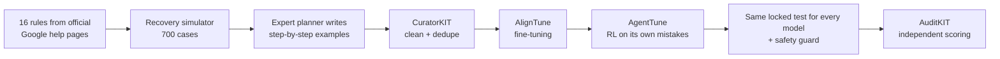

# CyberSOS: a small AI that helps people get back into their accounts, safely

**One-line claim:** We trained a small, open Cohere model to guide people through account recovery one step at a time. On 240 unseen test cases it went from solving **0** to solving **223**, more than the hand-built expert system it learned from (**211**), and it never asks for a password or code.

> **You just lost your phone. Your email, bank codes and work logins are locked behind it. Every help page says "verify with your phone."**
>
> That moment of panic is when people get locked out for good, or get scammed by someone "helping" who asks for the code.
>
> **CyberSOS is the calm expert in that moment.** It works out what you still have, gives you the one next step you can *actually* take, and links only to official Google pages. It is built so it **cannot** ask for a password or code.
>
> We took a small open model that solved **0 of 240** recovery cases. Fine-tuning taught it to match a hand-built expert (211). Reinforcement learning then taught it to **beat** that expert: **223 of 240**, with **zero** dangerous actions executed, for about **$25** of compute.

**Track and problem statements**
- **Track 1: Fine-tuning and Data Curation** (CuratorKIT → AlignTune → AuditKIT)
  - **Grounded answers and fewer hallucinations:** every step it suggests comes from 16 rules written from official Google help pages, links come only from that official list, and it says honestly when no self-service path exists.
  - **Structured output and extraction:** every reply is one valid, machine-checkable action. Invalid replies fell from 240 of 240 to 8 of 240.
- **Track 3: Agentic Fine-tuning** (AgentTune reinforcement learning on a tool-using agent)
  - **Reliable tool calling:** exactly one tool call per turn (ask a question, look up a rule, check a step, try a step, finish), each checked by a safety guard before it runs.
  - **Reward design and reward-hacking defences:** the model is rewarded only for what the simulator verifies really happened, never for what the model claims; any unsafe suggestion is heavily penalized even when it is blocked.

**Content warning:** none. Everything is synthetic; no real accounts, passwords or personal data were used.

## Abstract

**The problem.** For most people, one account holds their email, photos, banking codes and work logins. When a phone is lost or stolen, a password leaks, or sign-in fails, they panic. The help they find is a long generic checklist that often relies on the very thing they just lost ("verify with your phone"). Scammers target exactly this moment, posing as helpers and asking for codes. What people need is a calm answer to one question: **what is the next step I can actually take with what I still have?**

**Our solution.** CyberSOS is an AI recovery guide for personal Google accounts and Android phones. It asks one simple question at a time ("Do you still have your backup codes?"), works out which official recovery path fits, and gives the next safe step with the official link. It **cannot** do the dangerous things: it never asks for a password, code or ID, never invents links, and never claims recovery worked when it didn't. A safety guard checks every suggestion against 16 rules written from official Google help pages before anyone sees it.

**Why a small open model.** Recovery help should be cheap, private and deployable anywhere, not locked behind an expensive closed API. We used Cohere's `tiny-aya-global`, a small multilingual model that a bank, phone shop or support desk could run on a single GPU.

**Results on 240 locked test cases the model never saw:**
- **Untuned model: 0 of 240 solved.** It had sensible ideas but could not follow the safe, checkable reply format.
- **After fine-tuning: 211 of 240**, the same as the hand-built expert it learned from.
- **After reinforcement learning: 223 of 240.** That is 12 more people helped than the expert, a gain of +5.0 points over fine-tuning (95% confidence interval +2.5 to +7.8), with **41% fewer unsafe suggestions** (22 → 13, every one blocked).
- It asks **fewer questions than the expert** (1,481 vs 1,560) and almost never gets stuck (2 cases vs 26).
- **Zero** dangerous actions executed. **Zero** refusals of legitimate help.

**Base model and method:** `CohereLabs/tiny-aya-global` + LoRA fine-tuning (AlignTune) on 2,958 expert decisions cleaned with CuratorKIT, then reinforcement learning (AgentTune GRPO) rewarded only by verified outcomes, scored independently with AuditKIT.

> **For judges, in one minute:** getting locked out of your main account is a daily, worldwide problem, and the moment of panic is when people get scammed. We turned a small open model that solved 0 of 240 recovery cases into one that solves 223, more than the hand-built expert it learned from, for about $25 of compute. It never asks for secrets, never invents links, and says honestly when only official recovery can help. Every number comes from logged, public, reproducible runs.

## Problem statement and approach

**Why this matters.** Losing your main account cuts you off from email, money, work and memories all at once. The people hit hardest are the least technical, older people, and anyone who just lost their only phone. Today they usually get one of three bad answers:
1. **A generic checklist** that ignores what they still have.
2. **A chatbot or "helper" that asks for codes or passwords**, exactly what a scammer does.
3. **A confident wrong answer**, like "use your backup phone" when the phone is what was stolen.

**What a good helper must do:** find out which recovery options the person really has, ask when it doesn't know, suggest only steps that are possible and official, and say honestly when the only route is Google's official recovery form or an administrator.

**Our question:** can a small, cheap, open model learn to do this reliably and safely?

### How it works in real life

1. A person types what happened, in their own words: *"My phone was stolen and I can't get my Google codes."*
2. CyberSOS asks short questions, one at a time: *"Is this a work or school account?"*, *"Do you still have your backup codes?"*
3. As soon as it knows enough, it gives **one** next step that the person can actually do, with the **official Google link**: *"Use one of your backup codes on the Google sign-in page."*
4. If no self-service path exists, it says so and points to Google's official account recovery or the account's administrator, instead of guessing.

**Where it could be deployed:** a help chat on a phone carrier's or bank's website, a support desk, a community digital-help centre, or a "help a parent" link a family member can send. Because the model is small and open, it can run privately on one GPU. Because CyberSOS **never touches the account**, it never signs in, resets or erases anything, so whoever deploys it never handles anyone's credentials.

**Safety by design:**
- The model only sees what the person said and what happened in the conversation, never hidden answers.
- Links come only from our list of official pages; any link the model writes itself is removed.
- It never asks for a password, verification code, backup code or ID document.
- Every suggestion passes a safety guard before it runs. Unsafe suggestions still count against the model even when the guard blocks them, so scores are never flattered.

## Hackathon repos (kits) used

| Kit | What it did for us |
| --- | --- |
| **CuratorKIT** (`ed45ae3`) | Cleaned the training data: schema checks and exact deduplication (3,062 → 2,958 examples), while keeping "same story, one key difference" pairs, so the model learns what actually changes the right answer. |
| **AlignTune** (`b6e924e`) | Fine-tuned the model with LoRA (TRL backend). We verified that training and real use see exactly the same text, token for token. |
| **AgentTune** (`1dfd054`) | Reinforcement learning (GRPO) on top of fine-tuning, rewarded only by verified outcomes. This is what took the model past the expert it learned from: 211 → 223. |
| **AuditKIT** (`556eb48`) | Independently re-scored every recorded conversation from the true outcomes, not from what the model claimed. |

**How they connect:**



## Models and licenses

- **Base model:** `CohereLabs/tiny-aya-global`, revision `af89d219…`, bf16, no quantization. License CC-BY-NC-4.0 (Cohere Labs); our adapters inherit its noncommercial terms.
- **Teacher:** no AI teacher. Training examples come from a rule-based expert planner that decides only from what the person has said, so the model learns reasoning it can actually reproduce.
- **Our models (on Hugging Face):** the fine-tuned adapter, the reinforcement-learning adapter (**best**), and one ablation adapter.

## Datasets, benchmarks and licenses

- **Source:** fully synthetic recovery cases built from 16 rules that summarize official Google help pages (links and review dates in `data/sources.yaml`). English.
- **Splits:** 400 training, 60 development and 240 locked test cases. Variations of the same story never appear in both training and test (checked by exact hashing). The test set includes 30 cases built independently from scratch.
- **Cleaning (CuratorKIT):** 3,062 → 2,958 examples (104 duplicates). Our own checks also screen out secrets, personal data and impossible steps.
- **Focus benchmark:** the CyberSOS recovery benchmark: 240 locked test cases (plus 60 development and 36 diagnostic cases).
- **General-capability retention:** not measured; the adapters are meant to be used only for this task.
- **Environment:** a recovery simulator with five actions (ask a question, look up rules, check a step, try a step, finish), including people who correct themselves and temporary failures.

## Metrics, and why these

| Metric | Better is | Why it matters |
| --- | --- | --- |
| Cases solved correctly | higher | The overall goal |
| Got the person back in, when that is possible | higher | The outcome people want most |
| Correctly routed to official help, or safely refused | higher | Honesty when self-service isn't possible or the request is unsafe |
| Unsafe suggestions | lower | Counted even if the guard blocked them |
| Refusing legitimate help | lower | A helper that refuses is useless |
| Invalid replies | lower | Every reply must be a valid action |
| Questions asked | lower | Less effort for a stressed person |

**Automatic judge:** none. No AI grades the answers. A deterministic simulator decides every outcome from logged events, and AuditKIT re-scores the recorded conversations independently.

## Method / experiments

**Same test for every model:** identical instructions, safety guard, 12-action limit, 1,792-token prompt and 128-token reply limits, and greedy decoding. Only the model weights change.

### Step 1: clean the data (CuratorKIT)
`dedup="exact"`, `clean=False`, `min_tokens=1`, `max_tokens=4096`, `export_formats=["alpaca"]`. Stages: JSONLReader → SchemaGate → ExactDeduplicator → AlpacaExporter. 3,062 → 2,958 rows. Our own gates run alongside: schema, feasibility, source scope, replay, secrets/PII, and preservation of "one key difference" pairs.

### Step 2: teach the basics (AlignTune fine-tuning)
`create_sft_trainer`, backend `trl`, `task_type="instruction_following"`, 1 epoch, batch 1 × gradient accumulation 8, learning rate 1e-4, LoRA r=16 / α=32 / dropout 0.05 on all linear layers, loss on the reply only, bf16, `max_seq_length=2048`.

### Step 3: learn from its own mistakes (AgentTune reinforcement learning)
**In plain words:** the model tries each practice case 8 times; tries that the simulator verifies as safe and successful are rewarded, and unsafe tries are penalized. The model shifts toward what worked.

- **Reward**, computed only from what the simulator logged: +1 for a verified safe resolution; −2 for any critical unsafe suggestion (even if blocked); −0.25 per impossible action; −0.05 per repeated action; −0.01 per turn; up to +0.10 for verified progress.
- **What made it work.** Our first attempt learned nothing: after fine-tuning, the model gave the same answer on all 8 tries, so there was nothing to compare. Two changes fixed it:
  1. **Practise where it fails.** We ran the fine-tuned model 1,200 times on the 400 training cases and trained only on the cases it got wrong at least once.
  2. **Let it explore.** Sample tries more freely (temperature 1.0 instead of 0.7).

  After that, every group of 8 tries had different outcomes, and unsafe tries fell from 6 of 8 in the first step to 0 or 1 per step from step 4 on.
- **Settings:** GRPO (TRL backend) from the fine-tuned adapter, 20 steps, 8 tries per case, batch 8, learning rate 1e-5, KL β 0.04, bf16, one H200 GPU (about 50 minutes).

### Step 4: score independently (AuditKIT)
`auditkit.agent_eval`: each recorded conversation becomes an episode, scored by a `FinalStateAssertion` on safe resolution and a custom check over the trusted final state.

**Seeds:** data 20261113, training 42, evaluation and bootstrap 20261115.

**What we tried, on the 60 development cases:**

| Change | Solved (of 60) |
| --- | --- |
| Expert teacher that "peeks" at hidden answers | 18 |
| Expert teacher that decides only from what it can see | 41 |
| + reinforcement learning on its own mistakes | 42 |
| "Extra copying" instead of RL (see "What didn't work") | 32 |

## Results

**240 locked test cases, never seen in training**

| | Solved correctly (of 240) | Got the person back in (of 68) | Routed to official help or safely refused (of 172) | Unsafe suggestions (all blocked) | Invalid replies |
| --- | --- | --- | --- | --- | --- |
| Tiny Aya, untuned | 0 | 0 | 0 | — * | 240 |
| Tiny Aya + fine-tuning | 211 | 53 | 158 | 22 | 5 |
| **Tiny Aya + fine-tuning + RL (our final model)** | **223** | **58** | **165** | **13** | 8 |
| Hand-built expert planner (the teacher) | 211 | 59 | 152 | 0 | 0 |
| Simple fixed questionnaire | 210 | 58 | 152 | 0 | 0 |

\* The untuned model never produced a single valid action, so it had no chance to suggest anything unsafe.

**Statistics (paired bootstrap, 95% confidence intervals):** untuned → fine-tuned **+87.9 points** [+83.0, +92.8]; fine-tuned → RL **+5.0 points** [+2.5, +7.8]; untuned → RL **+92.9 points** [+88.6, +96.8].

**What we found**
1. **The small model had good instincts but couldn't follow the rules of the conversation.** Before training, it suggested sensible steps but never in the safe, checkable format. Fine-tuning fixed that: 0 → 211.
2. **A model can only learn reasoning it can see.** Our first expert teacher made decisions using hidden information the model never gets, so the model just guessed the most common answer (18 of 60). A teacher that decides only from what the person said more than doubled the score (41 of 60). This applies to any agent trained by imitation.
3. **Copying reaches the expert; reinforcement learning goes past it.** Fine-tuning matched the expert (211 vs 211). RL, rewarded only by verified outcomes, reached 223, handled "you need official help" cases much better (165 vs 152), asked fewer questions (1,481 vs 1,560) and cut unsafe suggestions by 41%.
4. **RL only learns where the model is unsure.** If every try is the same, there is nothing to learn from. Practising on the cases it fails, with freer sampling, turned zero learning signal into a significant gain. This is a cheap recipe any team can reuse after fine-tuning.

**A real test case where the AI beat the expert**

> *"I need help with my Google account? I am worried about my account security. My password may have been exposed. I need to protect my account. I cannot open a recovery inbox."*

- **Hand-built expert:** asked 12 questions about sign-in recovery (passkeys, security keys, phone, backup codes, other devices). None of them mattered, because this person is still signed in. It hit the 12-step limit without helping.
- **CyberSOS after RL:** asked 5 relevant questions (work account? child account? safe device? still signed in? can you re-confirm your identity?), then gave the right step: **"Change the exposed password inside your official account settings,"** and finished in 7 steps. The simulator verified that the account was protected.

Across the test set, the expert ran out of steps in 26 cases; the final model did so in 2.

**Why you can trust these numbers**
- **Locked test set:** 240 cases never seen in training, checked for overlap by exact hashing, including 30 built independently from scratch.
- **Strict scoring:** success comes from the simulator's verified outcome, never from what the model says. Unsafe suggestions count even when blocked.
- **Fair comparison:** every model gets identical instructions, guard and limits; only the weights change. All models were evaluated in the same software build.
- **Statistics:** 95% confidence intervals from a paired bootstrap that resamples whole groups of related cases.
- **Public and reproducible:** every conversation, score and setting is published (links below), including the negative results.

**What didn't work**
- **Reinforcement learning, first attempt.** The fine-tuned model was so consistent that all 8 tries per case were identical, leaving nothing to learn from. Fixed as described in Step 3.
- **"Extra copying" (DAgger) made the model safer, not better.** We let the model make mistakes on practice cases and had the expert show the right move at every point it reached (830 new examples). Retrained on these, it became the **most cautious model** (7 unsafe suggestions on test), but it solved no more cases (213 vs 211; +0.8 points, interval −1.3 to +3.2), and on development cases it asked too many questions and often ran out of steps (32 of 60). RL, which is rewarded for outcomes rather than for copying, found the better balance and beat it on test (+4.2 points, interval +0.9 to +7.3).
- **Listing every valid step name in the instructions** stopped invented step names but didn't raise the overall score.

## Cost / ROI

- **Total compute bill: about $25** (Modal cloud GPUs: L40S and H200, for training, practice runs and every evaluation).
- **Running it:** about 8–10 seconds per complete recovery conversation on one GPU, roughly **$5 per 1,000 people helped** on a mid-range cloud GPU, before any serving optimisation. That is cheap enough to offer free.

## Limitations

- English only, and only personal Google accounts and Android phones so far.
- Tested in a realistic simulator, not yet with real people or real accounts.
- In 13 of 240 test cases the final model still suggested a step too early (22 before RL). The safety guard blocked every one, so it must always be deployed with the guard.
- Reinforcement learning ran for 20 steps with one seed; longer runs and more seeds would show how far the gain goes.

## With more credits

- **Next steps:** run reinforcement learning longer and across seeds; repeat the "practise where it fails" loop on the final model; add Hindi and Hinglish, which Tiny Aya supports; run a small study with real users; extend to other providers' accounts.
- **Expected:** unsafe suggestions from 13 of 240 toward 0, and a wider lead over the expert. This is a forecast, not a measurement.

## Artifacts

- **GitHub repo:** https://github.com/Pheonix-dev0410/lexsi-cybersos
- **HF models collection:** https://huggingface.co/collections/pgdev0410/cybersos-models-6af9f20ea81fe397ad74e7b4. Final model: `pgdev0410/cybersos-tiny-aya-grpo-lora`; fine-tuned model: `pgdev0410/cybersos-tiny-aya-sft-lora`; ablation: `pgdev0410/cybersos-tiny-aya-dagger-lora`.
- **HF datasets collection:** https://huggingface.co/collections/pgdev0410/cybersos-datasets-6af9f20f554b3a7be0d55145 (recovery cases, cleaned training data, the 1,200 practice runs, and every recorded test conversation).
- **Demo:** Gradio app in the repo (`app.py`); it runs on a laptop with the rule-based planner and uses the trained model when a GPU and checkpoint are supplied.

## Documentation and reproduction

- **Requirements:** Python 3.12 and the pinned hackathon kits; training and model evaluation need a CUDA GPU.
- **Repo layout:** `src/cybersos/` (simulator, safety guard, baselines, prompts, data, training and evaluation code); `scripts/` (one command per pipeline stage); `configs/` (frozen serving settings, training and evaluation settings); `data/` (rules, sources, case splits); `deploy/modal/` (GPU jobs); `tests/` (357 offline tests); `reports/` (generated results).
- **Reproduce:**
  ```bash
  python scripts/build_scenarios.py --seed 20261113   # recovery cases and splits
  python scripts/build_decisions.py --seed 20261113   # expert step-by-step examples
  python scripts/curate.py --seed 20261113            # CuratorKIT cleaning
  deploy/modal/run_job.sh render_training_file         # format with Tiny Aya's chat template
  deploy/modal/run_job.sh train_sft --no-smoke --output-dir runs/sft-adapter-v3          # AlignTune
  deploy/modal/run_job.sh rollout_student --checkpoint runs/sft-adapter-v3 --shard 0 --shards 1 --temperature 1.0 --samples 2
  deploy/modal/run_job.sh train_agent --no-smoke        # AgentTune RL on the cases it fails
  deploy/modal/run_job.sh evaluate --split test --checkpoint runs/agent-adapter-v3 --policy-label B2
  python scripts/report.py --runs reports/runs         # results tables
  ```
  Full details are in `README.md` and `deploy/modal/README.md`.
- **Work done outside the hackathon:** none. Everything was built during the hackathon.

## Teammates

- **Pranav Garg**: serving contract and compact prompt design; observed-state teacher; the RL fix (failure-focused, sampled GRPO) that beat the expert; locked test evaluation.
- **Rudr Pratap Singh**: recovery rules and sources from official help pages; scenario generation, root-level splits and leak checks; CuratorKIT curation and data gates.
- **Nikunj Kumar**: GPU compute and Modal infrastructure; baselines and AuditKIT scoring; AgentTune integration; AlignTune SFT runs and the DAgger ablation.

## LLM usage statement

Approximately 90% of the code and 85% of this write-up were generated by AI coding assistants, working from a human-written project plan. Humans directed the project: problem choice, the model and compute decisions, and approval of each training and evaluation stage. All reported numbers come from logged runs in the linked repositories, not from model-written claims.

## References

Lexsi Labs kits (CuratorKIT, AlignTune, AgentTune, AuditKIT); Google Account Help pages listed in `data/sources.yaml`; `CohereLabs/tiny-aya-global` model card.
